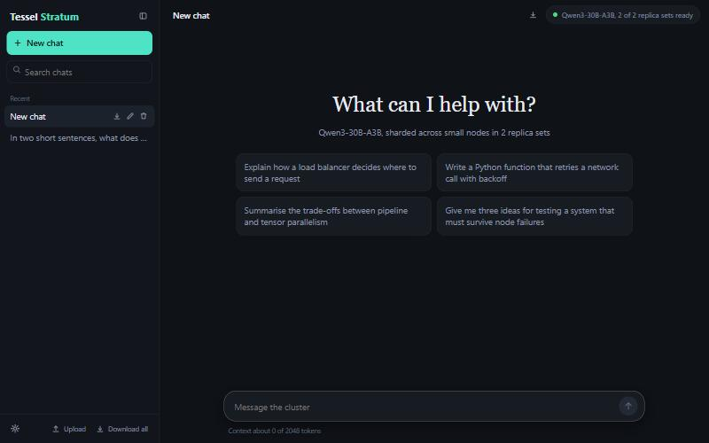
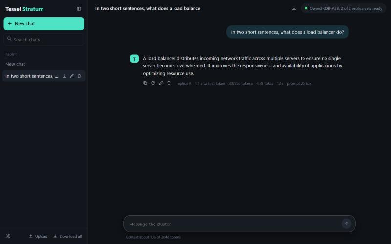

# Tessel Stratum LLM

Run large language models that are too big for any single machine by splitting them layer by layer across many small, fault-tolerant nodes.

Each node, such as an EC2 instance, holds only a few GB of the model. The nodes are connected as a cluster, can span several AWS accounts, and keep serving requests when individual nodes fail.

The goal is to let organizations run models far larger than one server's memory allows, using commodity cloud instances instead of a single large GPU machine.


## What is here

- `tessel/`: the app that runs on the head node. Chat API with a request queue, routing across replica sets, cluster control, a limit test, and the chat UI in `tessel/static/`.
- `deploy/`: provisioning, nginx config, the app service unit and the sync script.
- `tools/`: scripts that check what an AWS Academy sandbox allows.
- `tests/`: a mock model server for local testing.

## How it runs

llama.cpp's RPC backend splits the model across worker nodes. A replica set is one `llama-server` on the head plus its own workers. Chats go to a free replica set and wait in line when all are busy. If a node dies, only its set is rebuilt and the other keeps serving.

## Setup

### 1. Requirements

Python 3.10 or newer with `boto3`, `ssh`, and AWS credentials that can use EC2, ELB, S3 and SSM in one region. Credentials are read from the usual `AWS_*` environment variables or an AWS profile. They are never stored in this repository.

### 2. Configure

Copy the example config and fill in your values.

```
cp .env.example .env
```

| Variable | Purpose |
|---|---|
| `TESSEL_SSH_KEY` | path to the EC2 key file, required for `deploy/sync.sh` |
| `TESSEL_STATE_DIR` | folder for `cluster.json` and the admin token, default `~/.tessel` |
| `TESSEL_ADMIN_TOKEN` | admin password for the UI, generated into the state folder when empty |
| `TESSEL_KEY_NAME` | EC2 key pair name, default `vockey` |
| `TESSEL_INSTANCE_PROFILE` | instance profile for the nodes, default `LabInstanceProfile` |
| `TESSEL_REGION` | AWS region, default `us-east-1` |

`.env` is ignored by git.

### 3. Create the cluster

```
python3 deploy/provision.py
```

This launches the head node, four workers and a load balancer, writes their addresses to `cluster.json` in the state folder, and starts building llama.cpp and downloading the model on the nodes. Expect about ten minutes.

### 4. Publish the worker binary

```
python3 deploy/publish_rpc.py
```

This builds `rpc-server` on the head and uploads it to an S3 bucket. New workers boot from a standard image and fetch it, which is how replica sets are added and dead nodes are replaced.

### 5. Deploy the app

```
deploy/sync.sh push
```

This copies the app and an nginx config to the head, starts both services and prints the address of the load balancer. The first model load takes about five minutes.

### 6. Open the site

Open the address. The pill at the top right turns green when a replica set is ready. No account is needed.



### 7. Chat

Every reply shows the time to first token, tokens and speed, and which replica set answered. Messages can be edited, regenerated, copied or deleted, and a chat can be renamed or searched. If every replica set is busy, a request waits in line and shows its position.



### 8. Add a replica set

Open Settings, then Cluster. Paste the admin token, set the number of replica sets and press Apply. The token is in `admin_token` in the state folder. Existing sets keep serving while the new one loads.


### 9. Keep or move chats

Chats are kept only in the browser tab. Settings, then Data and privacy, downloads one chat or all of them as a file and uploads them again. Nothing is stored on the server.


## Protection

nginx limits request rate, connections per address and body size. The app limits messages per minute per address, the length of a conversation and the size of the waiting line. Only an admin token can load or stop models, change nodes or run the limit test. The nodes accept traffic only from each other and from the load balancer.
