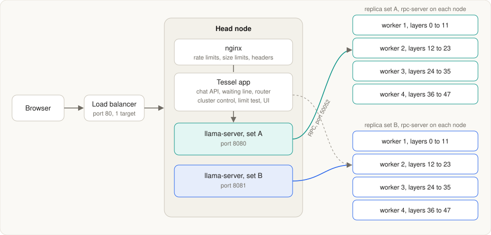
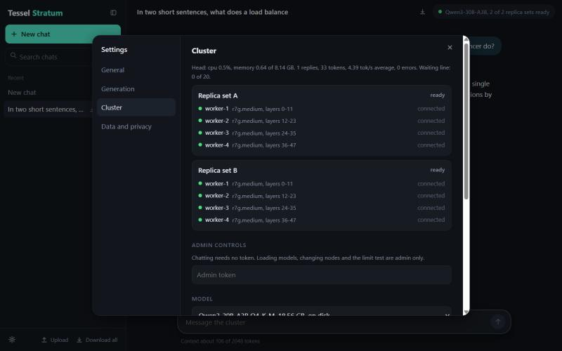
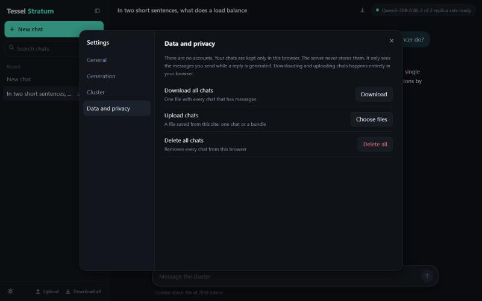
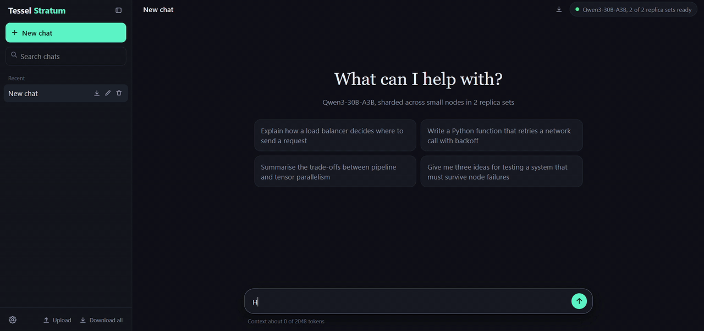

# Tessel Stratum LLM

Run large language models that are too big for any single machine by splitting them layer by layer across many small, fault-tolerant nodes.

Each node, such as an EC2 instance, holds only a few GB of the model. The nodes are connected as a cluster and keep serving requests when individual nodes fail. Spanning several AWS accounts is a goal, not built yet.

The goal is to let organizations run models far larger than one server's memory allows, using commodity cloud instances instead of a single large GPU machine.



## What is here

- `tessel/`: the app that runs on the head node. Chat API with a request queue, routing across replica sets, cluster control, a limit test, and the chat UI in `tessel/static/`.
- `deploy/`: provisioning, nginx config, the app service unit and the sync script.
- `tools/`: scripts that check what an AWS Academy sandbox allows.
- `tests/`: a mock model server for local testing.

## How it runs

llama.cpp's RPC backend splits the model across worker nodes. A replica set is one `llama-server` on the head plus its own workers. Chats go to a free replica set and wait in line when all are busy. If a node dies, only its set is rebuilt and the other keeps serving.

## Setup

### 1. Requirements

Python 3.10 or newer with `boto3`, `ssh`, and AWS credentials that can use EC2, ELB, S3 and SSM in one region. Credentials are read from the usual `AWS_*` environment variables or an AWS profile. They are never stored in this repository.

### 2. Configure

Copy the example config and fill in your values.

```
cp .env.example .env
```

| Variable | Purpose |
|---|---|
| `TESSEL_SSH_KEY` | path to the EC2 key file, required for `deploy/sync.sh` |
| `TESSEL_STATE_DIR` | folder for `cluster.json` and the admin token, default `~/.tessel` |
| `TESSEL_ADMIN_TOKEN` | admin password for the UI, generated into the state folder when empty |
| `TESSEL_KEY_NAME` | EC2 key pair name, default `vockey` |
| `TESSEL_INSTANCE_PROFILE` | instance profile for the nodes, default `LabInstanceProfile` |
| `TESSEL_REGION` | AWS region, default `us-east-1` |

`.env` is ignored by git.

### 3. Create the cluster

```
python3 deploy/provision.py
```

This launches the head node, four workers and a load balancer, writes their addresses to `cluster.json` in the state folder, and starts building llama.cpp and downloading the model on the nodes. Expect about ten minutes.

### 4. Publish the worker binary

```
python3 deploy/publish_rpc.py
```

This builds `rpc-server` on the head and uploads it to an S3 bucket. New workers boot from a standard image and fetch it, which is how replica sets are added and dead nodes are replaced.

### 5. Deploy the app

```
deploy/sync.sh push
```

This copies the app and an nginx config to the head, starts both services and prints the address of the load balancer. The first model load takes about five minutes.

### 6. Open the site

Open the address. The pill at the top right turns green when a replica set is ready. No account is needed.


### 7. Chat

Every reply shows the time to first token, tokens and speed, and which replica set answered. Messages can be edited, regenerated, copied or deleted, and a chat can be renamed or searched. If every replica set is busy, a request waits in line and shows its position.


### 8. Pick a model and node type

Open Settings, then Cluster, and paste the admin token. The token is in `admin_token` in the state folder.

- **Model:** the cards list DeepSeek-R1 distills (1.5B to 70B), Qwen3-30B-A3B, gpt-oss-120b and Qwen3-235B-A22B, from about 1 GB to about 112 GB. Select one and press Download. It is fetched to the head node and shows its progress. Set `HF_TOKEN` on the head for models that need a Hugging Face login.
- **Node type:** type any EC2 instance type and press Check. Its memory and CPU come from EC2.
- **Limit:** the most instances the cluster may run, head included, up to `TESSEL_HARD_MAX_INSTANCES`. Each model card shows how many nodes of the current type it needs, and Auto-fill sets the workers per set and the number of replica sets for the selected model within the limit. If the limit is too low it suggests a higher one.
- Press Apply to change nodes, then Load.

The memory estimate is the model file size split evenly across the workers, plus about 1.3 GB per node, and nodes are treated as 90% usable. It is a guide, not a guarantee.



### 9. Add a replica set

In Settings, then Cluster, raise the number of replica sets and press Apply. Existing sets keep serving while the new one loads.

### 10. Keep or move chats

Chats are kept only in the browser tab. Settings, then Data and privacy, downloads one chat or all of them as a file and uploads them again. Nothing is stored on the server.



## Protection

nginx limits request rate, connections per address and body size. The app limits messages per minute per address, the length of a conversation and the size of the waiting line. Only an admin token can load or stop models, change nodes or run the limit test. The nodes accept traffic only from each other and from the load balancer.

## Results and status

Measured on a real cluster of four 8 GiB single-CPU Graviton nodes with Qwen3-30B-A3B (Q4_K_M), one replica set:

| Concurrent users | Tokens/s per user | Tokens/s total |
|---|---|---|
| 1 | 4.4 | 3.4 |
| 2 | 2.7 | 5.2 |
| 4 | 1.4 | 5.3 |

First token in about 4 seconds, model load in about 4.5 minutes, a dead worker replaced in 53 seconds. A set tops out near 5 tokens/s because each node has one CPU core.

What is not done or not measured:

- Throughput with two replica sets answering at once was only tested with the mock server, not on real hardware.
- In one run an automatic replacement finished but its set did not reload the model. The cause was not confirmed, and the instance limit of the sandbox is the main suspect.
- Clusters across several AWS accounts are a goal and are not built.
- The model catalog, free node types and adjustable limit were added after the measurements above and have not been run on real hardware yet. Only Arm (Graviton) workers have a published build.

## Demo



Two messages sent to the Qwen3-30B-A3B cluster. The progress line shows tokens, time and speed while a reply streams, and the line under each reply shows which replica set answered.
